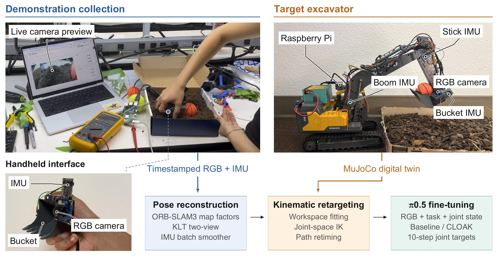

# UMI for Excavators: Learning Scooping from a Tabletop Excavator

[[Paper]](https://www.yumichael.com/api/assets/michaelyu469712409008.pdf) [[Dataset]](https://huggingface.co/datasets/amichaelyu/umi-excavator) [[Model]](https://huggingface.co/amichaelyu/umi-excavator)



## Setup

Python is managed with [uv](https://docs.astral.sh/uv/):

```sh
uv sync                    # hub, digital twin, data tools, tests
uv sync --group training   # + JAX / OpenPI for π0.5 training (add --group cuda on a Linux GPU host)
```

Each machine needs its own configs. Base each one on its example in `configs/`, saved under the same name without
`.example` (e.g. copy `configs/hub/local.example.json` to `configs/hub/local.json`). The examples hold the paper
rig's values:

| Config | What it holds | Updated by |
| --- | --- | --- |
| `configs/hub/local.json` | The Pi's URLs and token file (`hosts.pi`) and the GPU box for training (`hosts.lambda`) | You |
| `configs/hub/local_checkpoints.json` | The policy servers **Inference** can run | `policy serve --register`, or the hub ([Rollouts](#rollouts)) |
| `configs/hardware/hardware_map.json` | ESP32 pin map, homing, joint ranges and speeds, link-IMU and slew calibration | [Arm calibration](hardware/README.md#arm-calibration) |
| `configs/hardware/camera-calibration/camera.json` | Bucket camera intrinsics and camera-IMU extrinsics | [Camera calibration](hardware/README.md#camera-calibration) |
| `configs/hardware/robot_full4_calibrated.json` | The twin with your measured joint ranges and speeds | `python -m digital_twin.sim.build --calibrated` |

## Pipeline

1. **Hardware** ([hardware/README.md](hardware/README.md)): deploy the recorder and the ESP32 firmware, calibrate the
   bucket camera, record handheld demonstrations and calibrate the excavator's arm.
2. **Policy** ([policy/README.md](policy/README.md)): reconstruct the demonstrations, retarget them onto the twin,
   fine-tune π0.5 with or without CLOAK, evaluate and serve. Start from the
   [published dataset](policy/README.md#data) to skip collection, or serve a [pre-trained model](#pre-trained-models)
   to skip training.
3. **Rollouts** ([below](#rollouts)): run a served policy on the excavator from the hub.

The rest of the repository:

- `digital_twin/`: the MuJoCo twin, hardware calibration, joint-state estimation and the policy runner.
- `hub/`: one local web app for every UI (data collection, GPIO bridge, inference, data review).
- `configs/`: `hardware/` (hardware map, robot and self-mask configs, and `camera-calibration/`), `hub/` (hub apps
  and local settings) and `policy/` (training configs).
- `calibration-target/`: the AprilGrid used for camera calibration.

## Rollouts

Run a served π0.5 policy on the excavator from the hub. The excavator's hardware must be set up first
([hardware/README.md](hardware/README.md)): the ESP32 flashed, the recorder deployed to its Pi with `hosts.pi`
pointing at it, and the arm calibrated.

1. Start the hub natively, as for [arm calibration](hardware/README.md#arm-calibration), and open
   <http://127.0.0.1:8888/> (it lands on UMI data collection; the sidebar has the other apps):

   ```sh
   uv run python -m hub
   ```

   - **GPIO bridge** (`/gpio`): connects to the ESP32 (`ble://gpio`); manual pin control. Pin names and joint
     directions are in `configs/hardware/hardware_map.json`.
   - **Inference** (`/inference`): runs the served π0.5 policies on the excavator.
2. Register the policy servers **Inference** can run in `configs/hub/local_checkpoints.json` ([Setup](#setup); or
   start from `{"checkpoints": []}`). First serve a policy on the GPU box and forward its port
   ([policy/README.md](policy/README.md#serve)), then add it in one of three ways:
   - `uv run python -m policy serve <config> --register` writes the entry for you.
   - In **Inference**, open **Lambda endpoints**, enter a label, the forwarded URL and the prompt, and click
     **Check & add**. The hub connects once and only saves servers that are 4-joint CLOAK π0.5 policies.
   - Edit the file by hand. Each entry in `checkpoints` looks like this:

     ```json
     {
       "id": "cloak-dirt-good-cloak-1000",
       "task": "dirt",
       "mode": "cloak",
       "prompt": "scoop the dirt",
       "step": 1000,
       "gateway_url": "ws://127.0.0.1:8040",
       "gateway_env": "UMI_EXCAVATOR_CLOAK_DIRT_GOOD_CLOAK_URL"
     }
     ```

     | Field | Meaning |
     | --- | --- |
     | `id` | Unique name; also the label shown in the picker unless you add `label`. |
     | `task`, `mode` | Training task (`dirt`, `bottlecap`) and variant (`cloak`, `cloak_oov`, `baseline`, `noaug`, `pretrained`). |
     | `prompt` | The prompt the page fills in when you pick the checkpoint. |
     | `step` | Training step served. |
     | `gateway_url` | The policy server's websocket on this machine, i.e. the local end of the SSH port forward. Each checkpoint needs its own port. |
     | `gateway_env` | Optional environment variable that overrides `gateway_url` when set. |
     | `label`, `default` | Optional: display name, and `true` to preselect this checkpoint. |

   The page reads the file on **Refresh checkpoints**; there is no need to restart the hub.
3. In **Inference**:
   1. Put the arm in the standard pose: a policy run does not home. Home it from the command line (with the hub
      running); this drives the stick, boom and bucket into their top stops:

      ```sh
      uv run python -m digital_twin.policy.runner --home-only
      ```

      It runs outside the Inference page, so the page's **Stop** and **Reset** can't stop it: press Ctrl-C (the
      runner releases every button on exit), or **Release all** on the GPIO page. Like a policy run, it needs the
      calibrated arm IMUs.

   2. The profile is **π0.5 · standard tabletop excavator** (`pi05_tabletop_excavator`, all four joints). Pick a
      registered checkpoint and the prompt (`scoop the dirt`). Check the live camera, the twin's joint
      estimate and the observation the policy will see.
   3. **Start** runs the policy on the machine right away. There is no dry run and no arming step. The policy's
      ten predicted targets per chunk run as speed-limited button pulses, and the boom, stick and bucket IMUs
      give the joint state. A run is refused if they are not calibrated or not live.
   4. **Stop** ends the job and releases every button. **Reset** also releases every button. Closing every
      Inference page during a job triggers an emergency stop. Each run is recorded under
      `artifacts/inference-runs/`; success is judged by the operator (the paper's protocol is under
      [Results](#results)).

## Pre-trained models

[amichaelyu/umi-excavator](https://huggingface.co/amichaelyu/umi-excavator) has the two fine-tuned policies in the
[results](#results) below, both fine-tuned from `pi05_base`:

| Policy | Mode | Training |
| --- | --- | --- |
| `policy/cloak-1000` | `cloak`: CLOAK with the twin's self-mask | 1000 steps, batch 32, seed 20261006 |
| `policy/non-cloak-1000` | `baseline`: no CLOAK, bucket out of view | same |

Both take the prompt `scoop the dirt` and output 10-step chunks of absolute joint targets (slew, boom, stick,
bucket; radians, 10 Hz) in the `full4_calibrated` twin's joint space. Each folder is a self-contained bundle of
about 12 GB: parameters, normalization stats, the training manifest, the run options (`run/cloak-run.json`) and
`bundle.json`, which lists each file's SHA-256. To download and serve one, see
[policy/README.md](policy/README.md#a-released-policy); to run it, [Rollouts](#rollouts).

## Results

Table 1 of the paper. Both fine-tuned policies are the step-1,000 checkpoints released on
[Hugging Face](#pre-trained-models), trained on the 42 dirt demonstrations that passed manual replay review.

| Policy | Held-out action MAE ↓ | Scooping success ↑ | Checkpoint |
| --- | ---: | ---: | --- |
| Pretrained π0.5 base | 0.529 | 0% (0/20) | `pi05_base` |
| Fine-tuned, no mask | **0.258** | 50% (10/20) | `policy/non-cloak-1000` |
| Fine-tuned, CLOAK | 0.280 | **60% (12/20)** | `policy/cloak-1000` |

- **Held-out action MAE** is the normalized joint-action MAE on 42 demonstrations from an earlier, held-out
  session (504 one-second windows), averaged equally over episodes. It is the `normalized_mae` that the `eval`
  stage reports for the `policy` predictor ([Evaluation](policy/README.md#evaluation)); the base row is
  `eval-initial.json`.
- **Scooping success** is 20 physical attempts per policy, started from random positions and scored by an operator
  blind to which policy was running. A trial succeeds if the excavator scoops and lifts dirt. See [Rollouts](#rollouts) to run
  them.
- Both fine-tuned policies beat the base (two-sided Fisher's exact test: p = 4.4×10⁻⁴ without the mask,
  4.5×10⁻⁵ with CLOAK). The difference between CLOAK and no mask is not significant (p = 0.75), and the lower
  offline error does not predict the higher physical success.

To rerun the pipeline and metric (the `all` stage trains, then evaluates every saved step and the base;
[policy/README.md](policy/README.md) explains each stage):

```sh
uv run python -m policy all dirt-orb-cloak   # Fine-tuned, CLOAK
uv run python -m policy all dirt-orb         # Fine-tuned, no mask
```

Your numbers will differ from the table. The released policies were trained with an earlier version of this
pipeline on the reviewed recordings only; these configs train on all 85 published recordings with a holdout from
the same session, and the earlier held-out session is not in the published dataset.

## Citation

```bibtex
@misc{yu2026umiexcavators,
  title        = {{UMI} for Excavators: Learning Scooping from a Tabletop Excavator},
  author       = {Yu, Michael and Singh, Harsh and Ma, Nicole},
  howpublished = {CoRL 2026 UMI-Arena Workshop},
  year         = {2026},
  url          = {https://github.com/amichaelyu/excavator-umi}
}
```

## Acknowledgements
We would like to thank Actor Labs and Physical Intelligence for sponsoring the hackathon were the core ideas behind this paper were explored and for also providing all of the hardware. 

## License

The code is released under the [MIT License](LICENSE). The vendored
[`digital_twin/policy/vendor/openpi/`](digital_twin/policy/vendor/openpi/) file is from OpenPI and keeps its own
[Apache-2.0 license](digital_twin/policy/vendor/openpi/LICENSE).
