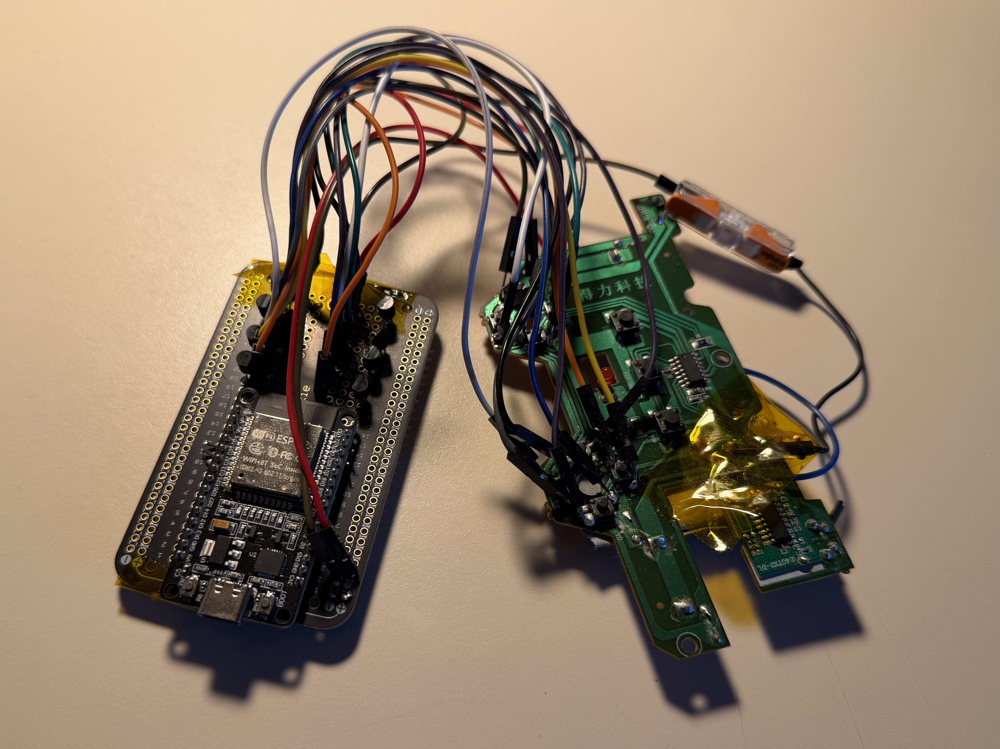

# Hardware

Everything needed to set up the hardware, in order: deploy the firmware and the recorder, calibrate the bucket
camera, record demonstrations, and calibrate the excavator's arm. The hardware is:

- the handheld bucket: a Raspberry Pi with the bucket camera and an IMU, running the recorder;
- the excavator: the same Pi and recorder on its bucket, IMUs on the boom and stick, and an ESP32 that presses
  the RC controller's buttons.

The code here:

- [`rc-control/`](rc-control/): ESP32 firmware that presses the excavator's RC controller buttons over Bluetooth LE.
- [`umi-data-collection/`](umi-data-collection/): the recorder and dashboard that run on the Raspberry Pi (camera
  and IMUs).

The hub (`uv run python -m hub`, <http://127.0.0.1:8888/>) is the Mac-side interface to both of them. See the
[main README](../README.md) for the full pipeline.

## Deploying to the hardware

How to put the firmware and the recorder on the devices. Run every command from the repository root on the Mac.

### ESP32 (RC control)

The ESP32 presses the excavator's RC controller buttons ([wiring and pins](#rc-control-esp32)). Flash the
firmware with PlatformIO over USB:

```sh
uvx platformio run -d hardware/rc-control -t upload
uvx platformio device monitor -d hardware/rc-control      # serial log, 115200 baud
```

It then advertises over Bluetooth LE as `gpio`, and the hub's **GPIO bridge** connects to it (`ble://gpio`).

### Raspberry Pi (recorder)

The same recorder runs on the handheld bucket's Pi and on the excavator's Pi. Deploy it to each one:

```sh
bash hardware/umi-data-collection/deploy/deploy.sh pi@<pi-host>              # or set UMI_PI_TARGET
bash hardware/umi-data-collection/deploy/deploy.sh --no-build pi@<pi-host>   # restart with the image already on the Pi
bash hardware/umi-data-collection/deploy/deploy.sh --diagnose pi@<pi-host>   # read-only Wi-Fi, power, container checks
```

`deploy.sh` packs the image's build context, `compose.yaml`, `deploy-on-pi.sh` and the IMU list into
`~/umi-dashboard` on the Pi. Then it runs `deploy-on-pi.sh` there, which is safe to rerun, even after a fresh OS
flash. That script:

- sets up the host: hostname `bucket`, the I2C buses, the wired links (eth0 `169.254.10.2/16`, USB-C gadget
  `169.254.10.3/16`), Wi-Fi, Docker and the access token;
- builds the `umi-dashboard` image and starts it with Docker Compose. It restarts unless stopped, on port 8000
  of every interface.

Finally, `deploy.sh` copies the Pi's access token to `hardware/umi-data-collection/.devices/bucket/access-token`.
Point `hosts.pi` in `configs/hub/local.json` at the Pi (its URLs and that token file) so the hub can reach it.

Options, as environment variables:

- `UMI_PI_WLAN_MAC` makes the setup refuse any Pi whose wlan0 MAC doesn't match.
- `UMI_PI_ETH0_ADDR` and `UMI_PI_USB0_ADDR` override the link addresses.

The `--diagnose` report is saved to `hardware/umi-data-collection/pi-diagnostics.txt`.

On the Pi, `~/umi-dashboard` is also the data directory, mounted at `/data`: `access-token`, `imus.json`,
`time-calibration.json` and `recordings/`. Manage the container with `sudo docker compose up -d | logs -f | down`
there.

## Camera calibration

The camera calibration (fisheye lens and camera–IMU) is stored in `configs/hardware/camera-calibration/camera.json`.

1. Print [`calibration-target/aprilgrid.svg`](../calibration-target/aprilgrid.svg) at full size. Measure the outer
   width of the black grid in millimetres.
2. [Record a take](#recording-demonstrations) with the handheld rig: move the camera slowly over the grid from
   several angles and distances, keeping the whole grid in view. Download the take's **Data** archive (`.tar`).
3. Fit the lens (OpenCV fisheye) and the camera–IMU rotation, time offset and gyro bias. This writes
   `configs/hardware/camera-calibration/camera.json` in place, which reconstruction uses; the raw outputs go to
   `configs/hardware/camera-calibration/<recording id>/`:

   ```sh
   uv run python -m policy.processing.camera_calibration <take>.tar --grid-mm <measured width>
   ```

   Add `--dry-run` to write only the raw outputs and leave `configs/hardware/camera-calibration/camera.json` unchanged.
   `configs/hardware/camera-calibration/camera.example.json` is the calibration of the paper's handheld rig.

## Recording demonstrations

Start the hub and open the dashboard at <http://127.0.0.1:8888/pi-dashboard>. The hub relays the Pi's API with the
access token from `hosts.pi`:

```sh
uv run python -m hub
```

Start a take, scoop with the handheld bucket, stop. Each take downloads as:

- **Data**: a `.tar` with `metadata.json`, `frames.csv` (frame timestamps), `imu.csv` and `video.mjpg`;
- **Video**: an MP4 export.

Training reads takes from `dataset/` ([layout](../policy/README.md#data)).

### Copy every take off the Pi

Instead of downloading takes one by one, copy the Pi's whole `recordings/` folder over SSH (the same `USER@PI` as
[`deploy.sh`](#raspberry-pi-recorder)). Stop any take that is still recording first. `--partial` lets an
interrupted copy resume, and rerunning the command only fetches new or changed files:

```sh
rsync -av --partial USER@PI:umi-dashboard/recordings/ recordings-from-pi/
```

On the Pi each take is a folder of loose files (`metadata.json`, `frames.csv`, `imu.csv`, `video.mjpg` and, once
exported, `video.mp4`). Run this from the repository root to convert every saved take that isn't already in
`dataset/` to the training layout:

```sh
for take in recordings-from-pi/*/; do
  id=$(basename "$take"); dest=dataset/$id
  [ -e "$dest/recording.tar" ] && continue                                  # already converted
  grep -q '"raw_data_saved": *true' "$take/metadata.json" 2>/dev/null || { echo "skip $id (not saved)"; continue; }
  mkdir -p "$dest"
  tar -cf "$dest/recording.tar" -C "$take" metadata.json frames.csv imu.csv video.mjpg
  cp "$take/metadata.json" "$dest/"
  [ -f "$take/video.mp4" ] && cp "$take/video.mp4" "$dest/" || echo "$id: no video.mp4 (MP4 export unfinished)"
done
```

If the Pi won't boot, read the card on a Mac instead. The recordings are on the card's ext4 partition, which macOS
can't mount, but `debugfs` (`brew install e2fsprogs`) can copy them out without writing to the card. Shut the Pi
down cleanly first, insert the card, find the Linux partition with `diskutil list` (usually `diskNs2`), then run:

```sh
sudo "$(brew --prefix e2fsprogs)/sbin/debugfs" -R 'rdump /home/<user>/umi-dashboard/recordings .' /dev/diskNs2
```

This writes a `recordings/` folder to the current directory. Convert it with the loop above, using `recordings/`
in place of `recordings-from-pi/`.

## Arm calibration

A policy run needs the excavator's link IMUs, joint ranges and speeds calibrated. With the ESP32 flashed and the
excavator's Pi deployed, start the hub natively (on macOS Docker can't reach Bluetooth) and open **Inference**
(<http://127.0.0.1:8888/inference>). Under **Hardware calibration**, tick the prerequisites, then **Calibrate**. It
moves the machine, fits the link IMUs, joint ranges, speeds and dead times, and merges them into
`configs/hardware/hardware_map.json`. A simulated run, which sends nothing, is CLI only:

```sh
uv run python -m digital_twin.hardware.calibrate
```

## RC control (ESP32)

The RC controller's buttons are operated using transistors connected to the ESP32. The
firmware ([`src/main.cpp`](rc-control/src/main.cpp)) advertises over Bluetooth LE as `gpio` with a Nordic UART
service (RX: write commands, TX: notify replies). Messages are newline-terminated JSON.



### Pins

| Pin | GPIO | Button (`configs/hardware/hardware_map.json`) |
| --- | --- | --- |
| D19 / D21 | 19 / 21 | base left / base right (slew) |
| D33 / D32 | 33 / 32 | boom up / boom down |
| D23 / D22 | 23 / 22 | arm up / arm down (stick) |
| D25 / D26 | 25 / 26 | bucket up / bucket down |

Every pin is `PUSH_HIGH`: released drives it to 0 V, pressed drives it to 3.3 V. The firmware also supports
`PULL_LOW` (open drain, pressed pulls to GND) and `INPUT_ONLY` pins. GPIO 1/3 (USB serial), 2 (on-board LED),
5 (strapping) and 14 (JTAG) are avoided. The joint-to-pin mapping, joint locks, homing order and calibrated joint
speeds are in `configs/hardware/hardware_map.json`, your machine's copy of
[`configs/hardware/hardware_map.example.json`](../configs/hardware/hardware_map.example.json).

### Protocol

```json
{"cmd": "trigger", "pin": 26, "ms": 200, "id": 1}
{"cmd": "press", "pin": "D26", "autorelease": true}
{"cmd": "release", "pin": "all"}
{"cmd": "state", "id": 2}
```

- `trigger` presses a pin for `ms` milliseconds (default 200, 1–60000) and then releases it.
- `press` and `release` hold and release a pin. With `"autorelease": true`, the hold is released when that
  client disconnects.
- `pin` is a GPIO number, a name like `"D26"`, or `"all"`.
- Each command gets an `ack` (or an `error`) that carries its `id`; `state` replies with every pin's state.

On the Mac, the hub's **GPIO bridge** app (`/gpio`) holds the BLE connection. It handles pin-map checks,
sequential pulses, homing and a stall watchdog. Everything else goes through it: manual control in the page,
policy rollout and hardware calibration in **Inference**, and scripts over `ws://127.0.0.1:8888/api/gpio/ws` (same
JSON).

## UMI data collection (Raspberry Pi)

The Pi records the bucket camera (a USB MJPEG camera at 1280×720) and its IMU. It serves a dashboard with a
live preview, IMU readouts and record controls. The same recorder runs for handheld demonstrations and on the
excavator. On the excavator it also reads the boom and stick IMUs for the inference-time joint estimate.

- [`recorder/`](umi-data-collection/recorder/): the server (`python -m recorder`). Camera capture
  (`capture.c`), IMU readers, recordings, the camera/IMU time alignment, MP4 export. The page itself is
  [`hub/web/data-collection/`](../hub/web/data-collection/) (`recorder/static` links to it), so the Pi and the hub
  serve the same files.
- [`devices/imus-bucket.json`](umi-data-collection/devices/imus-bucket.json): the IMUs, installed on the Pi as
  `imus.json`. `bucket` (LSM6DSL, I2C bus 1, `0x6a`) is the primary IMU and the only one recorded. `stick`
  (bus 3) and `boom` (bus 5) are MPU-6050s, reported live in `/api/status`.
- [`deploy/`](umi-data-collection/deploy/): the Docker image, Compose file and deploy scripts
  ([deploying](#raspberry-pi-recorder)).
- [`tests/`](umi-data-collection/tests/): run with the repo's tests (`uv run pytest hardware/umi-data-collection`;
  `bun test ./hardware/umi-data-collection/tests/test_latest_poll.js` for the page's polling).

### Run locally

```sh
cd hardware/umi-data-collection && uv run python -m recorder --no-hardware   # UI preview, devices offline
```

It serves <http://127.0.0.1:8000/>. Without `--data-dir` (or `$UMI_DATA_DIR`), the data directory is
`hardware/umi-data-collection/`. Binding anything other than localhost requires `--token-file`.
